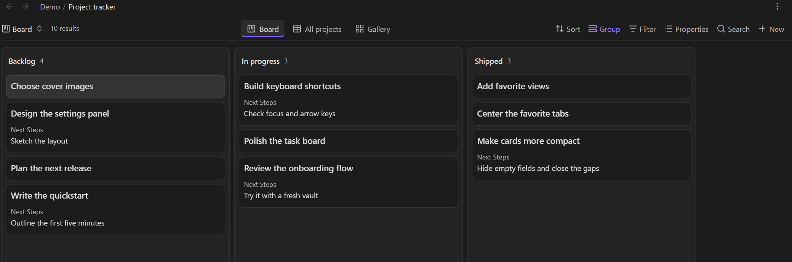
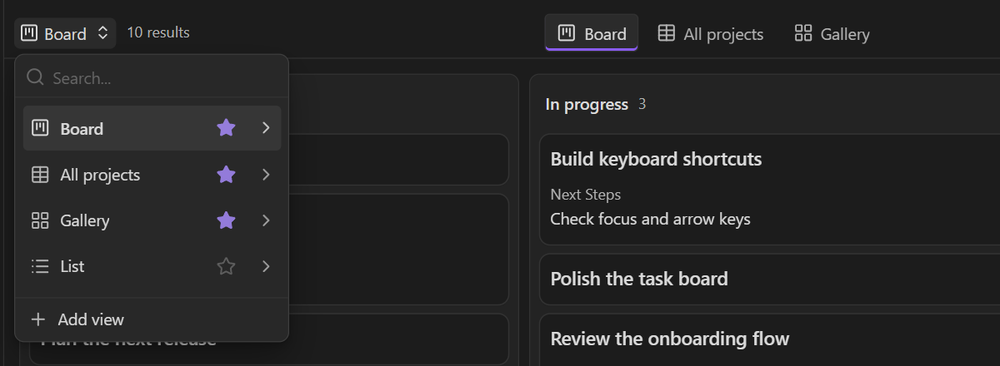
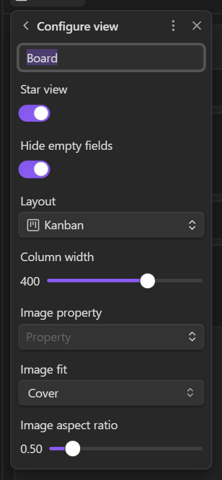

# Bases View Favorites

Star the saved views you use most in Obsidian Bases, then switch between them from a centered tab bar. Favorites belong to each base, so your task board, reading list, and project tracker can each have their own shortcuts.



*Your favorite views, one click away. Empty fields collapse so cards stay compact.*

## Features

- Star views from the native view dropdown or **Configure view**.
- Switch between Table, Kanban, Cards, List, and registered community layouts.
- Keep favorite tabs centered between the view selector and toolbar actions.
- Drag tabs to reorder them, or use the keyboard and context menu.
- Share favorites across panes while keeping each pane's selected view independent.
- Use the same favorites in standalone `.base` files and file-backed Markdown embeds.
- Scroll horizontally when tabs outgrow the available space.
- Hide empty native Kanban fields and highlight clickable cards on hover.

The native dropdown still lists all views. Unstarring the current view leaves it open, and the tab bar disappears when no views are starred.

## Requirements

Obsidian **1.14.4 or later**, with the **Bases** core plugin enabled. Desktop behavior was verified on Windows with Obsidian 1.14.4. Mobile hardware has not been tested; narrow desktop panes were checked down to 480 pixels.

This plugin adds navigation to existing Bases layouts. You can use it alongside [Bases Board View](https://github.com/DannieBGoode/obsidian-board-bases-plugin) and other community layouts.

## Install

The plugin is not listed in Obsidian's Community plugins directory yet.

### Download a build

1. Open the latest successful [CI run](https://github.com/DannieBGoode/obsidian-bases-view-favorites/actions/workflows/ci.yml) and download its **bases-view-favorites** artifact. GitHub requires you to be signed in to download workflow artifacts.
2. Extract `main.js`, `manifest.json`, and `styles.css` into `<your-vault>/.obsidian/plugins/bases-view-favorites/`.
3. Reload Obsidian, then enable **Bases View Favorites** under **Settings → Community plugins**.

When releases are available, the same three files can be downloaded from [Releases](https://github.com/DannieBGoode/obsidian-bases-view-favorites/releases).

### Build from source

With Node.js **22 or later** installed:

```sh
git clone https://github.com/DannieBGoode/obsidian-bases-view-favorites.git
cd obsidian-bases-view-favorites
npm ci
npm run check
node scripts/install.mjs "/path/to/your/vault"
```

Reload Obsidian and enable **Bases View Favorites** under **Settings → Community plugins**. The installer copies the build from `dist/`. Add `--enable` to also add the plugin to the vault's enabled plugin list for the next reload.

## Use

1. Open a `.base` file and click its view dropdown.
2. Click the star beside a view, or open **Configure view** and turn on **Star view**.
3. Click a favorite tab to switch views in the current pane.



Click a filled star to unstar a view, or an outlined star to add it to the tab bar.

You can also run **Bases View Favorites: Toggle star for current Bases view** from the command palette.

| Action | Control |
| --- | --- |
| Open a view | Click its tab, or focus it and press Enter or Space |
| Reorder favorites | Drag a tab, or press Alt+Left / Alt+Right while it is focused |
| Move keyboard focus | Left / Right, Home, or End |
| Unstar or reorder a view | Right-click its tab |

Reordering favorites leaves the native view list and default view unchanged.

## Native Kanban cards

**Hide empty fields** is enabled by default for native Kanban views. Open a view's **Configure view** popup to turn it off for that view. Missing values, blank text, and empty lists hide both the field label and placeholder. Zero and unchecked checkboxes stay visible.



The preference is saved as `bvfHideEmptyFields` on the view, independently of whether it is starred. Cards shrink to fit their visible fields, and the column closes the gaps between them. Native rendering, virtualization, and drag-and-drop are retained. Hovering a card highlights its surface and border; keyboard focus remains visible and reduced-motion preferences are respected.

## How favorites are saved

Favorites are stored in each view's options inside the `.base` file:

```yaml
views:
  - type: table
    name: Home
    viewFavorites:
      order: 0
```

The metadata follows the base through file sync, moves, and view renames. Note contents are unaffected. Disabling the plugin removes its interface and retains the metadata for later use.

Inline `base` code blocks are outside the current scope because they use a different save lifecycle.

## Development

```sh
npm ci
npm run check
```

`check` runs the TypeScript checker, unit tests, and production build. Build artifacts are written to `dist/`. CI runs the same checks on Windows and Linux.

For real-app smoke tests and compatibility notes, see [TESTING.md](TESTING.md). The toolbar integration uses private Obsidian APIs because the public API does not expose controls for all existing layouts. Rerun the native checks when updating Obsidian.

To prepare a release, keep `package.json`, `manifest.json`, and `versions.json` in sync and push a tag matching the manifest version exactly, such as `0.1.0`. The release workflow checks the build and creates a draft release with the three plugin files. See [Obsidian's release guide](https://docs.obsidian.md/Plugins/Releasing/Release%20your%20plugin%20with%20GitHub%20Actions) for the release format.

## Issues

[Report a bug or suggest an improvement](https://github.com/DannieBGoode/obsidian-bases-view-favorites/issues). Include your Obsidian version, layout type, and steps to reproduce. Use a small example base with sample notes when possible.

## License

[MIT](LICENSE)
